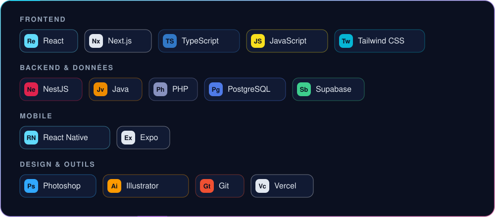

## About

Full Stack Developer. I build fast, well-structured web and mobile applications that are a pleasure to use, from the interface to the database.

- Clear interfaces designed around the user experience
- Clean architecture on both frontend and backend
- Open to any kind of collaboration in Full Stack web and mobile development

## Stack

## Projects

| Project | Description | Technologies |
| --- | --- | --- |
| **AgroFarm Manager** | Full farm management application | Next.js, React, NestJS, PostgreSQL |
| **Coffee Corner** | Mobile coffee ordering app | React Native, NestJS, Supabase |
| **MonTemps** | Time management: schedule, tasks, goals (Android APK) | React Native |
| **Portfolio** | My personal website, [check it out](https://rico-portfolio-one.vercel.app) | Next.js, TypeScript, Vercel |

## GitHub Activity

## Contact me

